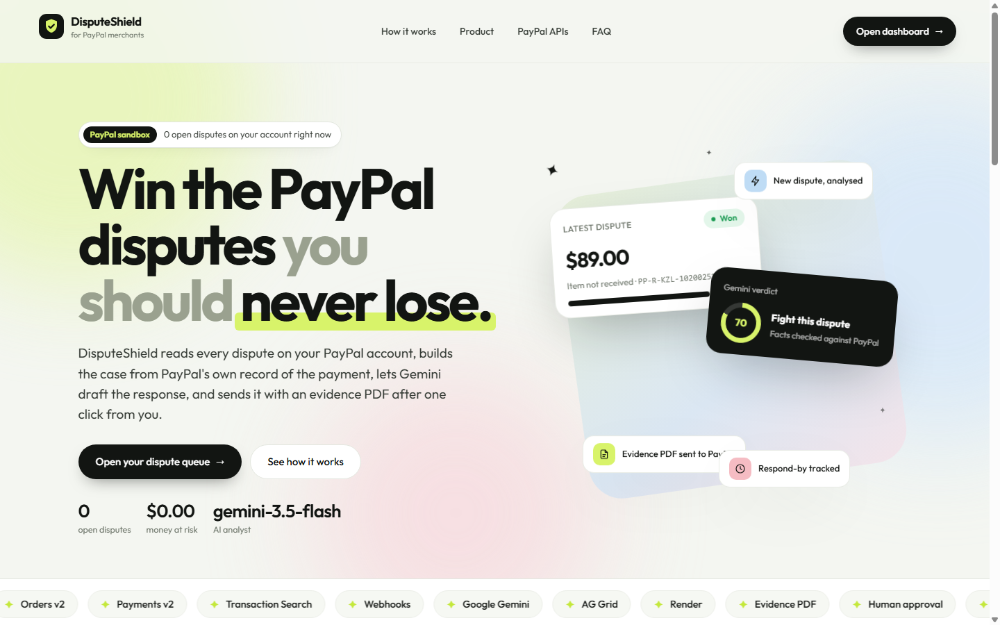
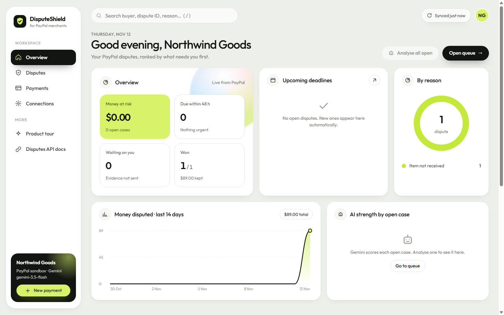
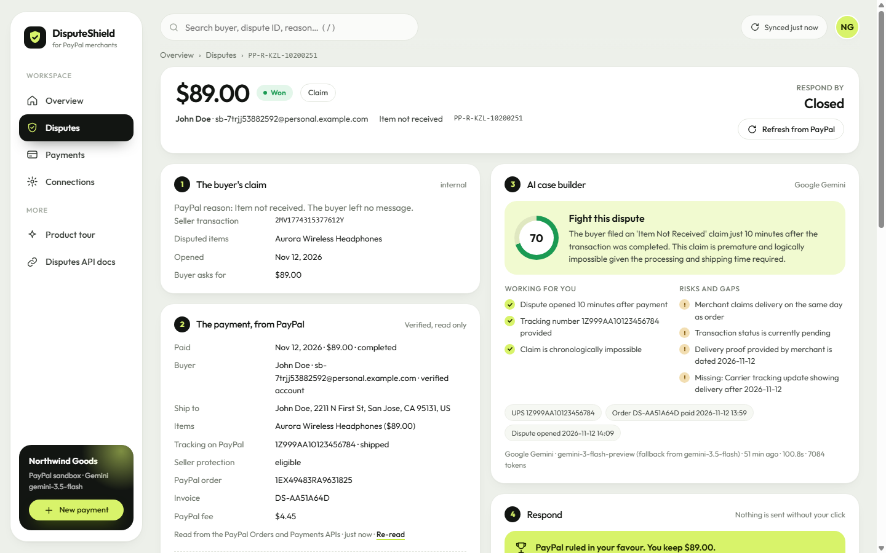

# DisputeShield

**AI dispute defence for PayPal merchants.** DisputeShield reads every PayPal dispute on the merchant's account, builds the case file from PayPal's own record of the payment (order, buyer, ship-to address, items, tracking, seller protection) plus the merchant's fulfilment facts, asks Google Gemini whether to fight, picks the PayPal evidence type, drafts the response, and submits it through the PayPal Disputes API with an evidence PDF after one click of approval.

Built for the **PayPal AI Hackathon**. Everything runs on real APIs: there is no demo mode, no mock data and no canned AI answer.



## The problem

When a buyer opens a PayPal dispute, the merchant has a fixed window to respond with the right evidence. Small sellers often miss the deadline, send the wrong evidence type, or skip it because the process is slow and confusing. Every lost case costs the order value plus a dispute fee.

## What DisputeShield does

1. **Dispute queue.** Every dispute from `GET /v1/customer/disputes`, in an AG Grid table sorted by response deadline, with money at risk, cases due within 48 hours, cases waiting on you, and wins. The server polls PayPal every minute and, on a public https URL, registers a PayPal webhook for `CUSTOMER.DISPUTE.*` so new disputes arrive live (server-sent events to the browser).
2. **Case file from PayPal.** For each dispute the server reads the capture (`/v2/payments/captures/{id}`) and its order (`/v2/checkout/orders/{id}`): payer, ship-to address, items, tracking already on the order, fee, seller-protection status. Payments not made through Orders v2 fall back to Transaction Search. The merchant adds what PayPal cannot know (carrier, delivery proof, listing, refund ID, notes); a new tracking number is also pushed to the PayPal order (`/v2/checkout/orders/{id}/track`).
3. **AI case builder.** Gemini returns a schema-checked verdict: `FIGHT`, `REFUND` or `NEED_INFO`, a 0 to 100 strength score with reasons and risks, the PayPal evidence type, the response to PayPal, a message to the buyer, and the exact facts it used (shown as chips so the merchant can check each one). New disputes are analysed automatically when they arrive.
4. **Human approval.** The merchant edits the draft and clicks **Approve and submit**. Nothing reaches PayPal without that click.
5. **Submission.** Evidence goes to `provide-evidence` as `PROOF_OF_FULFILLMENT` (with tracking), `PROOF_OF_REFUND` (with refund ID) or `OTHER`, with an evidence PDF generated on the server (PayPal facts, fulfilment facts, the merchant's statement). If PayPal refuses a format, DisputeShield resends the next one (typed without PDF, then `OTHER` with the details in the notes) and logs every refusal with PayPal's debug ID.
6. **Talk or refund.** Send the AI-drafted message to the buyer (`send-message`) at stages where PayPal allows it, or accept the claim and refund (`accept-claim`) with a second confirm click.
7. **Full lifecycle in the sandbox.** Take a real sandbox payment, dispute it as the buyer on sandbox.paypal.com (Report a problem), and play PayPal's part with the sandbox-only `require-evidence` and `adjudicate` endpoints to see the case end as won or lost.

The buttons on each case come from the dispute's HATEOAS links, so the UI only offers what PayPal allows at that moment.

## The app

A light, responsive interface (desktop, tablet and phone) with a product tour and a merchant workspace:

| Page | Route | What it shows |
| --- | --- | --- |
| Product tour | `#/` | Hero with live numbers from your PayPal account, how it works, features, FAQ |
| Overview | `#/dashboard` | Money at risk, deadlines, disputes by reason, money disputed over 14 days, AI strength per case, recent activity and payments |
| Disputes | `#/disputes` | AG Grid queue with status filters and search |
| Case | `#/disputes/{id}` | Buyer's claim, PayPal's payment record, your fulfilment facts, Gemini's verdict, respond, sandbox controls, activity |
| Payments | `#/payments` | Payments taken through DisputeShield and their dispute status |
| Connections | `#/settings` | PayPal sign-in, webhooks, background check, Gemini model chain, store profile, security |

The queue syncs on its own (PayPal webhooks plus server-sent events, and a one-minute poll); the Sync button fetches immediately. Animations respect `prefers-reduced-motion`.





## PayPal APIs used

| API | Endpoint | Purpose |
| --- | --- | --- |
| OAuth 2.0 | `POST /v1/oauth2/token` | Client-credentials token, cached, retried |
| Orders v2 | `POST /v2/checkout/orders`, `POST …/{id}/capture`, `GET …/{id}`, `POST …/{id}/track` | Take a payment, read payer/items/ship-to, add tracking |
| Payments v2 | `GET /v2/payments/captures/{id}` | The disputed transaction: amount, fee, seller protection, order link |
| Transaction Search | `GET /v1/reporting/transactions` | Facts for payments not made through Orders v2 |
| Disputes v1 | `GET /v1/customer/disputes`, `GET /v1/customer/disputes/{id}` | Queue and case detail |
| Disputes v1 | `POST …/{id}/provide-evidence` (multipart, with PDF) | Submit the approved evidence |
| Disputes v1 | `POST …/{id}/send-message`, `POST …/{id}/accept-claim`, `POST …/{id}/escalate` | Talk to the buyer, refund, escalate |
| Disputes v1 (sandbox) | `require-evidence`, `adjudicate` | Play PayPal's decision |
| Webhooks | `GET/POST /v1/notifications/webhooks`, `POST /v1/notifications/verify-webhook-signature` | Register and verify `CUSTOMER.DISPUTE.*` events |

## AI used

**Google Gemini** through the Generative Language REST API (`generateContent`) with `responseMimeType: application/json`, a strict `responseSchema` (enums for the action and evidence type) and temperature 0.2. Default model `gemini-3.5-flash`; if it is busy (503/429), timed out or retired (404), the server tries the next model in `GEMINI_FALLBACK_MODELS` (default `gemini-3.5-flash-lite`, `gemini-flash-latest`) and shows which model answered. The system prompt forbids inventing facts, separates PayPal-verified facts from merchant-entered ones, and asks for the exact facts used. Output is validated and clamped on the server (enums, score 0 to 100, 2,000-character notes) before it is stored or shown. If Gemini fails, the merchant sees the error; there is no canned fallback.

## Sponsor tools

- **AG Grid Community** powers the dispute queue (sorting, quick filter, custom cell renderers, theming API). If the CDN cannot load, the same rows render as a plain table.
- **Render** hosts it as a single web service (`render.yaml` included).

## Run it locally

Requirements: **Node.js 18.17 or newer**. There are **no npm dependencies**.

```bash
git clone https://github.com/XSTRANGER-7/disputeshield.git
cd disputeshield
cp .env.example .env      # fill in the keys below
npm start                 # or: node server.js
```

Open http://localhost:3000. The startup log shows whether PayPal sign-in worked and which Gemini model is used.

### Environment variables

| Variable | Required | Notes |
| --- | --- | --- |
| `PAYPAL_CLIENT_ID`, `PAYPAL_CLIENT_SECRET` | Yes | developer.paypal.com > Apps & Credentials. Tick **Customer disputes** and **Transaction search** under Features |
| `PAYPAL_BASE_URL` | No | `https://api-m.sandbox.paypal.com` (default) or `https://api-m.paypal.com` |
| `GEMINI_API_KEY` | Yes | aistudio.google.com |
| `GEMINI_MODEL`, `GEMINI_FALLBACK_MODELS` | No | Default `gemini-3.5-flash`, then `gemini-3.5-flash-lite,gemini-flash-latest` |
| `STORE_NAME`, `STORE_CURRENCY`, `STORE_POLICY` | No | Merchant context for the AI and the evidence PDF |
| `APP_PASSWORD` | Live: yes | Password for the dashboard. With live PayPal and no password, write actions are refused |
| `PUBLIC_URL` | No | Public https URL for PayPal return links and the webhook (Render's `RENDER_EXTERNAL_URL` is used automatically) |
| `PAYPAL_WEBHOOK_ID` | No | Use an existing webhook instead of registering one |
| `SUPABASE_URL`, `SUPABASE_KEY` | Recommended | Supabase project URL and key; see Database |
| `KEEP_ALIVE`, `KEEP_ALIVE_SECONDS` | No | Self-ping to stop free hosts sleeping; automatic on Render, every 600 s |
| `POLL_SECONDS`, `AUTO_ANALYZE`, `DATA_DIR` | No | Poll interval (default 60), auto-analysis of new disputes (default on), data folder |

## Database (Supabase)

DisputeShield keeps its own work in Supabase so it survives restarts and redeploys: a snapshot of every dispute, AI analyses, responses sent, activity, payments taken through the app and merchant fulfilment facts. PayPal stays the source of truth for disputes and money.

1. Supabase dashboard > SQL Editor > New query: paste [supabase/schema.sql](supabase/schema.sql) and run it once. It creates seven `ds_*` tables and a `ds_case_overview` view.
2. Set `SUPABASE_URL` and `SUPABASE_KEY` (a secret `sb_secret_...` key is best; a publishable `sb_publishable_...` key works with the policies in the SQL). The key stays on the server.
3. Restart. Anything already in `data/store.json` is uploaded on the first start. Without Supabase the app uses `data/store.json`.

The landing page and dashboard numbers (disputes handled, won, money kept, Gemini analyses, responses sent, latest activity) come from this database, and the queue can be exported as CSV.

## Make real test data

On **Payments**, **Create 3 test orders** makes real PayPal sandbox orders from a small catalogue. Approve each as a sandbox Personal buyer, dispute two or three on sandbox.paypal.com with different reasons, then answer them in DisputeShield. Every record is a real PayPal sandbox transaction; nothing is invented.

## Try the full flow in the sandbox

1. Click **New sandbox payment**, approve it with a sandbox **Personal** account in the same currency region as your sandbox business account (a US buyer for a USD store; an India buyer gets "This seller doesn't accept payments in your currency"). DisputeShield captures it and adds your tracking number to the PayPal order.
2. Log in to `sandbox.paypal.com` as that buyer (an Incognito window avoids a stale login), open the payment in Activity and choose **Report a problem**. PayPal's sandbox create-dispute API is not used: it needs a separate buyer-side app, and with merchant credentials PayPal answers `No permissions to set target_client_id`.
3. The dispute appears in the queue and Gemini analyses it. Open it, review the facts and the draft, then **Approve and submit to PayPal**.
4. Use **Play PayPal's part** to settle the case and watch it turn **Won**.

## Deploy to Render

1. Push this repo to GitHub (public).
2. In Render: **New > Blueprint** and pick the repo (uses `render.yaml`), or **New > Web Service** with start command `node server.js`.
3. Set `PAYPAL_CLIENT_ID`, `PAYPAL_CLIENT_SECRET` and `GEMINI_API_KEY`. Optionally `APP_PASSWORD`.
4. On start the server registers the PayPal webhook for `https://<your-app>.onrender.com/api/webhooks/paypal`.
5. Add `SUPABASE_URL` and `SUPABASE_KEY` so analyses, activity and notes survive the free plan's temporary disk and redeploys.
6. Keep it awake for judges (free instances otherwise sleep after 15 idle minutes and take about a minute to wake):
   - **Built in:** on Render the server pings its own public URL every 10 minutes (`KEEP_ALIVE`, on automatically when `RENDER` is set). Connections shows the last ping.
   - **Backup 1, GitHub Actions:** [.github/workflows/keep-awake.yml](.github/workflows/keep-awake.yml) pings every 10 minutes once you add the repository variable `APP_URL` (Settings > Secrets and variables > Actions > Variables).
   - **Backup 2, UptimeRobot (free):** add an HTTP(s) monitor for `https://<your-app>.onrender.com/api/health` every 5 minutes; it also emails you if the app goes down.
   - One service awake all month uses about 730 of the 750 free instance hours, so keep only this one free service in the Render workspace.

## Project structure

```
server.js            HTTP server, API routes, PayPal return/cancel, webhook, live events, background agent
lib/config.js        .env loader and settings
lib/paypal.js        PayPal client: OAuth, Orders, Payments, Transaction Search, Disputes, Webhooks
lib/records.js       Case file from PayPal (capture -> order, or Transaction Search)
lib/ai.js            Gemini analyst: JSON schema, validation, retries and model fallback
lib/normalize.js     PayPal dispute -> UI model, actions from HATEOAS links
lib/pdf.js           Zero-dependency PDF writer for the evidence file
lib/evidence.js      PayPal evidence objects with fallbacks, and the evidence PDF content
lib/store.js         Data store: Supabase write-through with data/store.json as a backup
lib/supabase.js      Minimal Supabase (PostgREST) client
supabase/schema.sql  Tables, policies and a case overview view
public/              index.html, styles.css, app.js (vanilla JS, hash router, AG Grid from CDN)
test/                unit and API tests (node --test, no dependencies)
```

## Tests

```bash
npm test          # node --test: 13 unit tests + 8 API tests against a real server started without keys
```

The unit tests cover the PayPal dispute mapping, AI output validation, evidence fallbacks, the PDF writer, the case file built from PayPal's capture/order/Transaction Search data and the multipart encoding. The API tests check that PayPal routes refuse to run without credentials, the security headers, path traversal, bad JSON and unverifiable webhooks.

The full flow was also run live on Nov 12, 2026 against the PayPal sandbox and Gemini: payment captured, tracking added to the order, dispute opened by the buyer, analysed by Gemini, answered with supporting info and evidence plus PDF, and settled in the merchant's favour (Won). The UI was driven in headless Chrome at 1440, 768 and 390 px: every page, link, filter, search, case open, modal and mobile menu, with no console errors and no horizontal overflow.

## Security notes

- Secrets live only in `.env` or Render environment variables; `.env` and `data/` are git-ignored.
- PayPal and Gemini are called only from the server. The browser never sees a key.
- Webhook events are accepted only after PayPal's `verify-webhook-signature` says `SUCCESS`.
- Every submission, message and refund needs an explicit merchant click; refunds need a second confirm.
- Sandbox-only actions are refused when `PAYPAL_BASE_URL` points to live PayPal.

## License

MIT, see [LICENSE](LICENSE).
